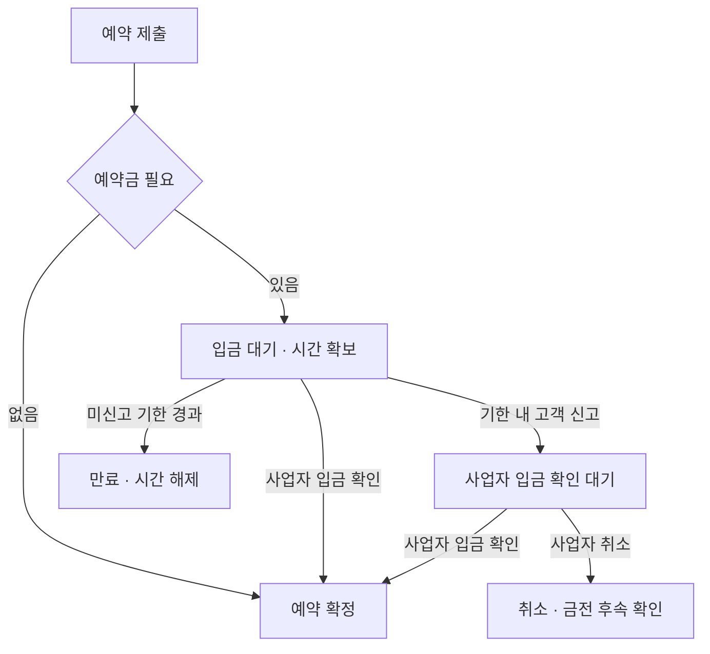

# 유저 플로우와 화면 구성

## 고객의 주 경로

예약 링크 → 시술 선택 → 날짜·가능 시간 선택 → 이름·전화번호·동의 및 예약 조건 확인 → 예약 결과.

예약금이 없으면 결과는 ‘예약 확정’이다. 예약금이 있으면 ‘예약금 입금 대기’로 안내하고 계좌·기한·확인 요청 버튼을 보여준다. 고객 계정을 만들게 하지 않는다.

## 예약금 분기

고객 신고는 실제 입금 확인이 아니다. 신고가 접수된 예약은 사업자가 검토할 때까지 시간을 유지한다. 늦은 입금은 만료 예약을 자동 복원하지 않는다.

## 사업자 주 경로

가입·이메일 확인 → 로그인 → 샵/영업시간/첫 시술 설정 → 예약 링크 복사 → 오늘 일정 확인.

예약금 사용 시 계좌와 안내를 설정한다. 확인 대기 건은 대시보드 상단에서 바로 열 수 있게 한다. 수동 예약·시간 차단·취소는 같은 캘린더를 사용한다.

## 필요한 화면

| 화면 | 꼭 보여줄 정보 | 주요 행동 |
| --- | --- | --- |
| 소개 | 누구를 위한 서비스인지, 현재 사용 가능 상태 | 시작하기 |
| 가입/로그인 | 이메일·비밀번호, 오류, 이메일 재전송·재설정 | 로그인/가입 |
| 첫 샵 설정 | 상호·영업시간·첫 시술 | 저장 후 링크 받기 |
| 오늘 일정 | 날짜, 예약 시간, 시술, 상태, 확인 대기 수 | 예약 열기/수동 추가/시간 차단 |
| 시술 설정 | 가격·소요시간·준비시간·예약금·공개 여부 | 시술 저장 |
| 예약금 설정 | 샵 계좌·입금 신고 기한·고객 안내 | 저장 |
| 고객 예약 | 시술·빈 시간·최종 조건, 필수 입력 오류 | 예약금 없음: 예약하기 / 있음: 예약 신청하기 |
| 고객 결과 | 확정/입금대기/확인대기/만료 등 실제 상태 | 링크 저장/입금 확인 요청/취소 |
| 사업자 예약 상세 | 연락처·시간·입금 상태·변경 이력 | 입금 확인/취소/완료 |
| 알림·설정 | 연결 여부, 최근 실패, 재연결 | 알림 켜기 |

## 화면 설계 방향

- 모바일에서 오늘 해야 할 일이 먼저 보인다. 넓은 주간 캘린더만 강요하지 않고 날짜별 목록도 제공한다.
- [DESIGN.md](DESIGN.md)의 공통 색상·서체와 모바일 기준을 적용한다. 상태는 색과 문구를 함께 표시한다.
- 손가락으로 누르기 쉬운 버튼과 명시적인 입력 라벨을 사용한다. 키보드가 떠도 다음 행동이 가려지지 않게 확인한다.
- 저장 중 상태·버튼 중복 클릭 차단·실패 시 입력 보존을 기본으로 둔다.
- ‘아직 예약 없음’과 ‘불러오기 실패’를 구분한다.
- 지갑/카드 같은 장식보다 시간·예약 상태·다음 행동이 먼저 보이게 한다.
- 예약금·취소 안내는 제출 전에 확인할 수 있게 한다. 동의 체크박스를 미리 선택하지 않는다.
- 데모 데이터는 실제 사용자 데이터와 화면·저장을 분리하고 항상 데모임을 표시한다.

## 첫 개발 단계의 화면 범위

01-bootstrap에서는 소개 페이지와 개발 설정 상태 안내, health API만 구현한다. 이후 실제 Auth/DB를 연결한 단계부터 가입·예약 화면을 활성화한다. 준비되지 않은 기능이 성공한 것처럼 연출하지 않는다.
